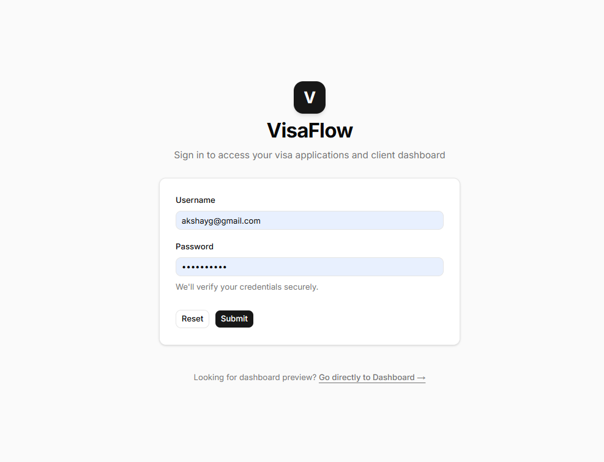
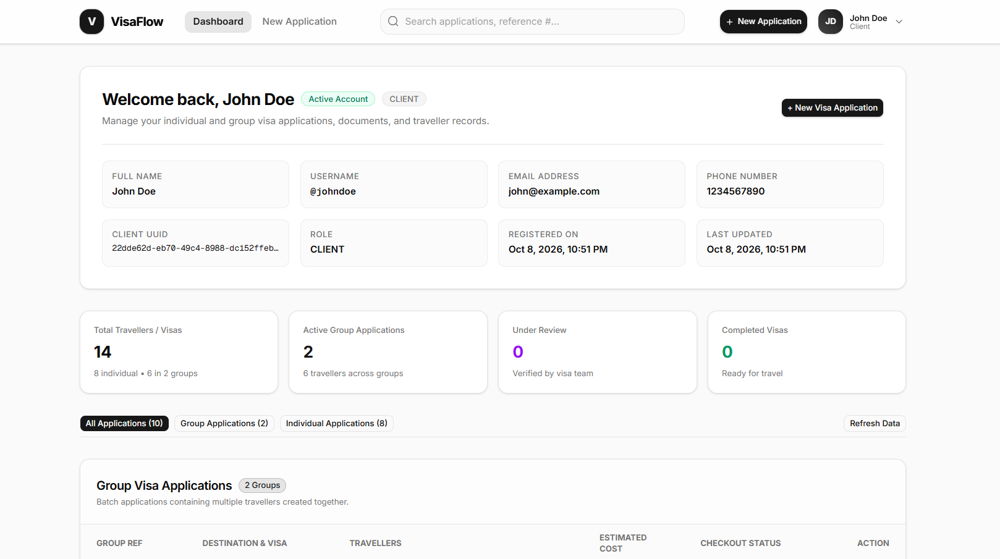
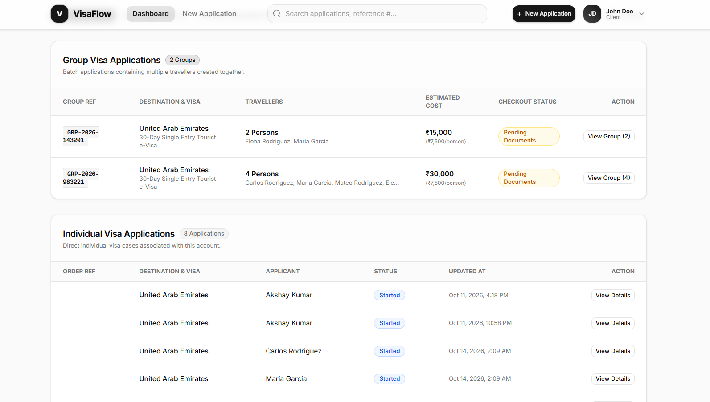
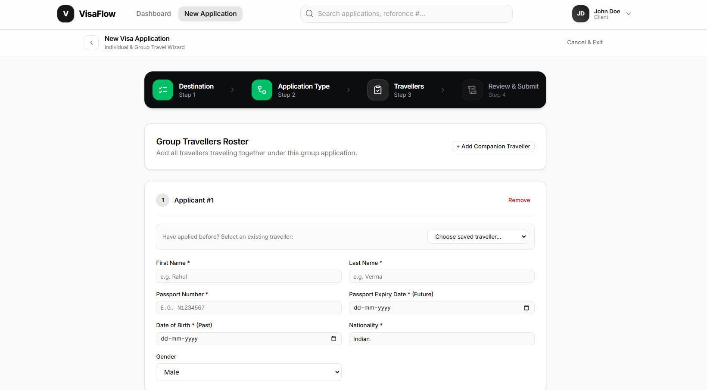
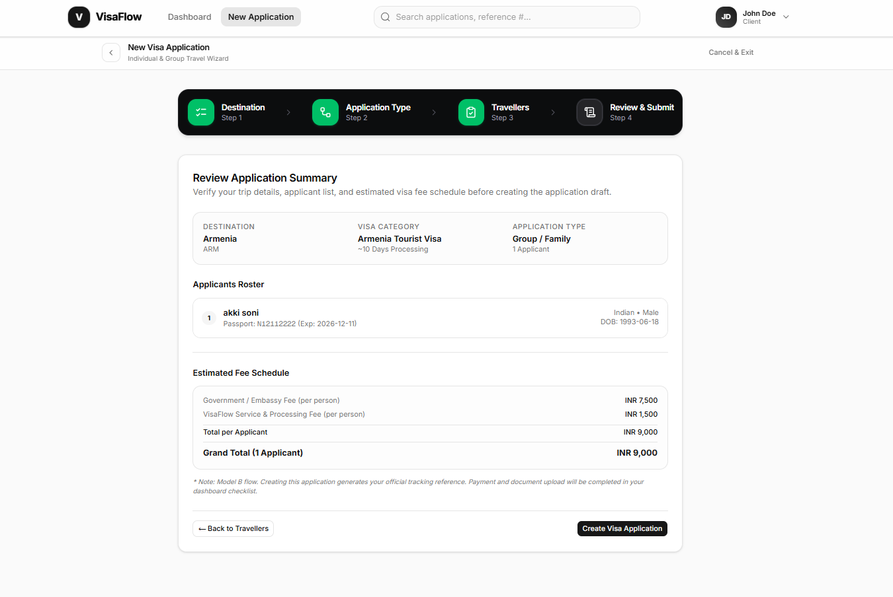
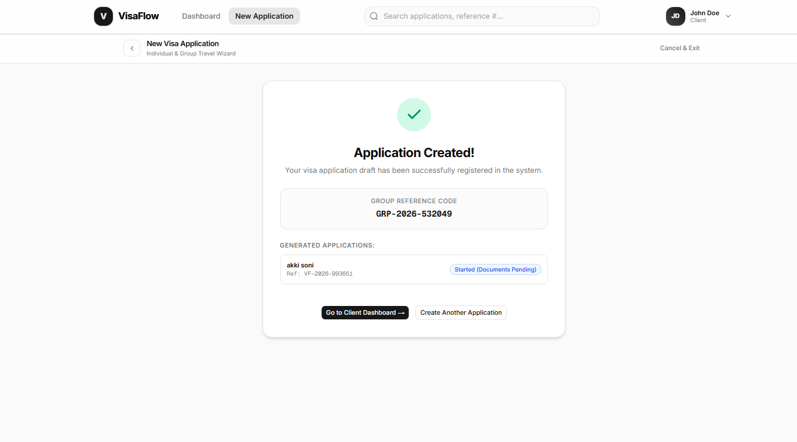
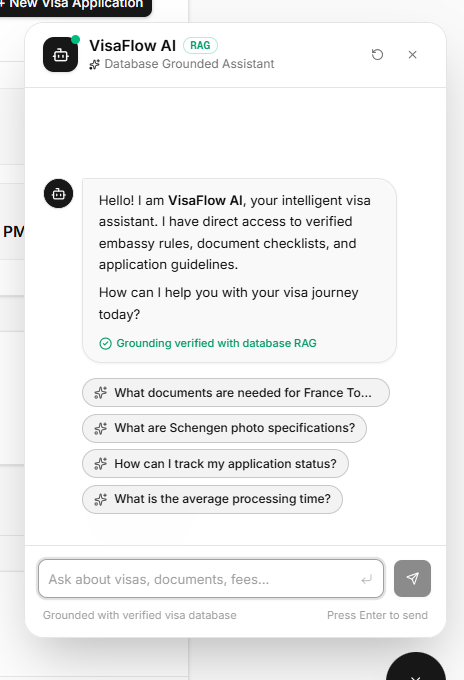

# VisaFlow ✈️🌐

VisaFlow is a full-stack visa application and dossier management platform designed for clients, travellers, and visa operations teams. It streamlines individual and group travel visa processing, document uploads, and tracking.

---

## 📸 Application Screenshots

### 1. User Authentication & Login
Secure sign-in for clients to access their applications and dashboard with JWT bearer tokens.

---

### 2. Client Dashboard & Profile Overview
Overview of active client account, registration metadata, application counts, and quick actions.

---

### 3. Application Portfolio (Group & Individual)
Real-time tracking of group travel batches and individual visa cases with document statuses and fees.

---

### 4. New Application Wizard: Travellers Roster (Step 3)
Dynamic multi-passenger roster supporting passport details, expiry validation, and saved traveller profiles.

---

### 5. Application Summary & Fee Schedule (Step 4)
Transparent breakdown of government/embassy fees and processing fees prior to submission.

---

### 6. Application Created Confirmation
Instant group tracking reference code and individual application reference generation.

---

### 7. VisaFlow AI Assistant & RAG Chatbot
Intelligent conversational assistant with live database grounding for requirements, fees, document checklists, and application tracking.

---

## 🤖 AI Visa Assistant & Chatbot (`/api/chat`)

VisaFlow includes an intelligent AI assistant grounded directly in the live database via Retrieval-Augmented Generation (RAG):

- **Pluggable Architecture**: Seamlessly switch between **OpenAI** (`gpt-4o-mini`), **Google Gemini** (`gemini-1.5-flash`), or zero-configuration **Local RAG Fallback**.
- **Live Grounded Data**: Ingests real-time country requirements, visa products, fees, processing timelines, and document checklists from `CountryRepository`, `VisaTypeRepository`, and `ChecklistRequirementRepository`.
- **Application & Group Status Tracking**: Recognizes reference numbers (`GRP-...`, `VIS-...`) and returns current status and applicant summaries.
- **Graceful Resilience**: If an external LLM key is absent or rate-limited, the system automatically falls back to the internal database assistant without downtime.

### API Endpoints
- `POST /api/chat` - Send user message, multi-turn history, or context hints (countryCode, visaTypeId, referenceNumber).
- `GET /api/chat/providers` - Inspect configured and active AI providers.

---

## 🛠 Tech Stack

- **Backend**: Spring Boot 3.4 / Java 17, Spring Security (JWT), Spring Data JPA, Hibernate, PostgreSQL, Bean Validation
- **AI & RAG Engine**: Pluggable AI Client SPI (OpenAI, Google Gemini, Built-in RAG Assistant)
- **API Documentation**: SpringDoc OpenAPI / Swagger UI (`/swagger-ui.html`)
- **Frontend**: Next.js 15, React, TypeScript, Tailwind CSS, shadcn/ui
- **Testing**: JUnit 5, Mockito, Spring Boot Starter Test (MockMvc)
